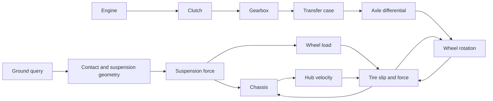

# Physics model overview

This page is for readers who want to understand or modify the vehicle calculations. It is an implementation map, not a complete derivation or a claim that the models reproduce every real tire, suspension, or powertrain. For exact behavior, follow the linked solver code and configuration structs.

## How the main models connect

The wheel-to-tire and tire-to-wheel links show the coupled wheel-speed and tire-force calculation, not separate solver stages.

## Tire forces

The wheel solver derives longitudinal slip from wheel peripheral speed and hub velocity. It derives slip angle from wheel-local velocity, with a low-speed blend. A camber-to-drift curve can add lateral contact-patch drift; this changes the slip input and is not a direct camber-thrust force term.

The `Fx` curve maps slip ratio to a longitudinal friction coefficient, and `Fy` maps slip angle in degrees to a lateral coefficient. The solver applies tire/load scaling and `MaxFx`/`MaxFy`, then couples longitudinal and lateral demand using the combined-slip settings. `RelaxationLength` makes the slip response build over time instead of changing instantly. The exact coupling and force limits are in the solver; tuning curves should be treated as part of the model, not just visual presets.

Useful entry points:

- Configuration and telemetry: [VehicleWheelStructs.h](../Source/KinetiForge/Public/VehicleWheelStructs.h)
- Slip, relaxation, and tire-force calculations: [VehicleWheelSolver.cpp](../Source/KinetiForge/Private/VehicleWheelSolver.cpp)
- Wheel integration and handoff between suspension and tire stages: [VehicleWheelRuntime.cpp](../Source/KinetiForge/Private/VehicleWheelRuntime.cpp), [VehicleWheelPhysics.cpp](../Source/KinetiForge/Private/VehicleWheelPhysics.cpp)

## Wheel spin and chassis angular momentum

Each runtime wheel tracks its world-space spin axis from suspension geometry. At wheel preparation it records the current speed and the previous step's axis; at finalization it computes the change in `H = WheelConfig.Inertia * AngularVelocity * axis`. The opposite angular impulse is accumulated on the wheel's chassis once per macrostep, including in flight. This captures spin acceleration/braking and axis changes from steering, suspension articulation and chassis rotation. It does not use `AngularAcceleration`, which is the result of only the last internal tire substep. Reflected drivetrain inertia is excluded because upstream shafts have no defined 3D axes in this model.

Chaos uses the chassis's existing inertia to turn the accumulated angular impulse into angular velocity; wheel code must not divide by chassis inertia. Configure chassis mass/inertia for the vehicle assembly as usual. This model adds the wheels' relative spin momentum, not separate full wheel rigid bodies or wheel inertia tensors. SI angular impulses are converted to Chaos centimeter units by multiplying by 10,000.

UE 5.3's free-body rotation does not transport angular velocity to preserve world angular momentum when an asymmetric body's orientation changes. The body's `WheelCoordinator` therefore maintains one `FVehicleChassisMomentum` history and adds `(I_previous_world - I_current_world) * current_angular_velocity` to its pending angular impulse once per physics step. Both tensors use the principal mass frame, including `RotationOfMass`. Wheel impulses remain independent; the correction neither gathers them nor needs to run after them. It also applies to a coordinator with no wheels: a resting body gets no impulse, while a rotating body receives the free-rotation correction. A newer engine body with native gyroscopic integration enabled bypasses this fallback.

This is a sampled integration correction, not exact energy-conserving rigid-body integration. Momentum and energy error remain timestep dependent, especially at high angular speeds. It does not restore a cached total momentum, suppress collision/aero impulses or add damping. Changes of body identity or principal inertia seed new history. Wheel initialization/suspension reset also clears chassis history; after a discontinuous pose/velocity change, call `ResetChassisMomentumHistory()` on the coordinator as well as resetting wheel spin history. The coordinator uses the existing frozen-GT auxiliary physics callback, including standalone-wheel setups; purely numerical native integrations must advance their own `FVehicleChassisMomentum` once per chassis step. Keep one coordinator per physical chassis.

For a closed-system airborne test, disable angular damping, aero resistance **and physics sleeping**. Chaos sleeping may zero a small angular velocity even when damping is zero. The `KinetiForge.Chassis.Momentum` tests use actual UE physics frames to check an asymmetric wheel-less body and four independent wheel runtimes through fixed-steering and straighten-before-braking cycles, without a DriveAssembly. The wheel speeds are prescribed so those tests isolate the angular exchange from engine/clutch control. They do not validate motorcycle handling.

With the default `ImpactPoint` force application, the chassis already receives the ground's external contact moment. Subtracting the wheel spin change assigns the wheel its share of that moment; adding a second drive/brake reaction would count it twice. The legacy `WheelCenter` mode intentionally changes the ground-force moment arm to reduce pitch/roll and remains a handling approximation, not a globally conserving contact model.

Axis changes are sampled between macrosteps, so gyroscopic coupling is explicit and timestep dependent. Use the recommended fixed physics timestep and validate high wheel speeds against smaller steps. The first step seeds axis history without a gyro kick, but still transfers any spin acceleration during that step. A suspension reset clears the history; native callers changing a body's pose discontinuously must call `ResetSpinMomentumHistory()` before preparing the next wheel step. The exchange is per wheel and all wheel contributions add on their respective chassis bodies. This does not implement free steering dynamics, rider balance control or a validated motorcycle tire/contact model.

## Suspension and contact

The suspension stage queries the world for a contact using one of the configured line, sphere, box, or multi-sphere modes. It solves the selected linkage geometry to find hub position and orientation, then computes spring, damping, and optional anti-dive, anti-squat, and anti-roll effects. The resulting load contributes to chassis forces and to the load used by the tire calculation. Optional unsprung mass adds a separate suspension integration path.

The supported independent geometries are straight-line, MacPherson, and double wishbone; generated axle setups also support solid axle. These are runtime geometry calculations, not rendered-link simulations. Lookup curves can replace some detailed geometry inputs. For the exact stages and assumptions, see:

- Configuration: [VehicleSuspensionStructs.h](../Source/KinetiForge/Public/VehicleSuspensionStructs.h)
- Geometry, force, and unsprung-mass integration: [VehicleSuspensionSolver.cpp](../Source/KinetiForge/Private/VehicleSuspensionSolver.cpp)
- Contact queries and reactions: [VehicleSuspensionContactBridge.cpp](../Source/KinetiForge/Private/VehicleSuspensionContactBridge.cpp)

The contact-query bridge has an engine-version-specific threading constraint. This plugin began on UE 5.3 and currently uses the older `UWorld` physics-query path, whose `FHitResult` carries UObject references. The runtime copies the needed contact data for numeric consumers, but worker-thread code must not dereference the hit component or physical material references. Newer Unreal versions provide alternate physics-thread query and handle APIs that may allow this boundary to be replaced when integrated correctly; this code has not been migrated. See [Runtime Maintenance](RuntimeMaintenance.md) before changing this boundary.

## Engine and drivetrain

The power unit is a one-dimensional rotational model. The engine solver advances engine state using its torque curve, throttle, inertia, and internal losses. The clutch and gear path transfer torque between engine and gearbox; the gearbox applies the selected ratio. The transfer case distributes output among connected axles, and each axle differential distributes torque between that axle's left and right wheels. Torsional stiffness and damping are represented in the clutch/power path rather than by a 3D driveshaft mesh.

Useful entry points:

- Engine configuration and drivetrain values: [VehicleDrivetrainStructs.h](../Source/KinetiForge/Public/VehicleDrivetrainStructs.h)
- Engine state and torque: [VehicleEngineSolver.cpp](../Source/KinetiForge/Private/VehicleEngineSolver.cpp)
- Clutch and gear-path calculations: [VehicleTransmissionSolver.cpp](../Source/KinetiForge/Private/VehicleTransmissionSolver.cpp), [VehicleGearboxSolver.cpp](../Source/KinetiForge/Private/VehicleGearboxSolver.cpp)
- Differential and axle distribution: [VehicleDifferentialSolver.cpp](../Source/KinetiForge/Private/VehicleDifferentialSolver.cpp), [VehicleAxleSolver.cpp](../Source/KinetiForge/Private/VehicleAxleSolver.cpp)
- Whole-vehicle order and internal substeps: [VehicleDriveRuntime.cpp](../Source/KinetiForge/Private/VehicleDriveRuntime.cpp), [VehiclePowerUnitRuntime.cpp](../Source/KinetiForge/Private/VehiclePowerUnitRuntime.cpp)

The current power unit is single-clutch. More complex topologies such as a dual-clutch transmission require additional shared engine-load and output-composition work; see the extension boundaries in [Runtime Maintenance](RuntimeMaintenance.md).

## A practical way to change a model

1. Start from the relevant configuration struct and the corresponding solver listed above.
2. Trace where the solver's inputs are prepared and where its outputs are consumed using the [Source Guide](SourceGuide.md).
3. Change one behavior at a time and compare it in a controlled vehicle setup. The existing automation tests under `Source/KinetiForge/Private/Tests/` can show how specific behavior is checked, but they do not replace driving and tuning the affected setup in Unreal Editor.

For callback, thread, and lifetime constraints that apply across these models, read [Runtime Maintenance](RuntimeMaintenance.md).
