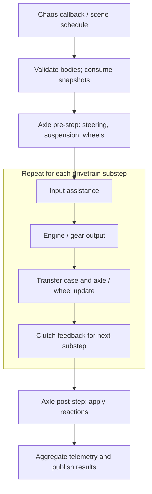

# Vehicle runtime maintenance guide

This guide is for developers changing the C++ runtime. For installation and vehicle setup, start with [Getting Started](GettingStarted.md); for a shorter map of the source layers, see the [Source Guide](SourceGuide.md).

The plugin's public components remain the asset, Blueprint, and editor-facing configuration API. C++ runtime objects perform the normal vehicle simulation, so existing vehicle assets do not need a new drivetrain graph. The repository README lists the engine versions the maintainer has tested; those results are not a compatibility guarantee for every later engine release.

For the main execution path, start with [`FVehicleDriveRuntime::Update`](../Source/KinetiForge/Private/VehicleDriveRuntime.cpp). The listed sequence below follows that function and its axle/contact calls.

## Physics step at a glance



The order above is the macrostep order in `FVehicleDriveRuntime::Update`: validate the chassis and axle bodies before consuming commands; prepare each axle; for every drivetrain substep update input assistance, power-unit output, transfer-case distribution and clutch feedback; then post-step the axles and publish telemetry. Suspension preparation/integration and tire/drivetrain integration are separate stages. Paired independent suspension integrates both unsprung masses together through local substeps; a single-wheel fallback remains available. WheelCoordinator manages wheels associated with a body but does not advance the drivetrain. Drive owns that update, including bindings to more than one body.

## Where to make a change

| Change | Start here |
| --- | --- |
| Vehicle assembly, component discovery, editor preview, and binding | [VehicleDriveAssemblyComponent.cpp](../Source/KinetiForge/Private/VehicleDriveAssemblyComponent.cpp) |
| Whole-vehicle ordering and transfer-case distribution | [VehicleDriveRuntime.cpp](../Source/KinetiForge/Private/VehicleDriveRuntime.cpp) |
| Engine, clutch, and gear-path composition | [VehiclePowerUnitRuntime.cpp](../Source/KinetiForge/Private/VehiclePowerUnitRuntime.cpp), then the corresponding solver |
| Default input assistance | [VehicleInputSolver.cpp](../Source/KinetiForge/Private/VehicleInputSolver.cpp) |
| Axle stages and feedback | [VehicleAxlePhysicsAssembly.cpp](../Source/KinetiForge/Private/VehicleAxlePhysicsAssembly.cpp), then `VehicleAxleSolver` |
| Suspension, limits, and anti-roll coupling | [VehicleSuspensionSolver.cpp](../Source/KinetiForge/Private/VehicleSuspensionSolver.cpp) |
| Wheel/tire integration and suspension handoff | [VehicleWheelRuntime.cpp](../Source/KinetiForge/Private/VehicleWheelRuntime.cpp), [VehicleWheelPhysics.cpp](../Source/KinetiForge/Private/VehicleWheelPhysics.cpp) |
| Collision queries and contact reactions | [VehicleSuspensionContactBridge.cpp](../Source/KinetiForge/Private/VehicleSuspensionContactBridge.cpp) |
| Configuration, command, and result transfer | `VehiclePowerUnitBridge`, `VehicleAxleBridge`, `VehicleWheelBridge` |
| Callback admission, teardown, and body identities | `VehiclePhysicsScene`, `VehiclePhysicsSchedule`, `VehiclePhysicsStep`, `VehiclePhysicsBodyBinding` |

## Thread and state ownership

- The game thread owns component configuration, Blueprint interaction, editor preview, and display caches.
- Bridges transfer value snapshots and commands to a single simulation consumer, then publish result copies back. Shared ownership keeps a bridge alive; it does not permit arbitrary concurrent access to its runtime.
- Physics integration and queries execute outside transfer locks.
- Default Drive updates run on the worker callback. The existing thread selection also supports the actual UE Frozen GameThread callback. Aero and spring-arm helpers use Frozen GT. ATP remains available for existing Blueprint dependencies.

Configuration setters submit snapshots for physics to consume at a step boundary. GT Tick also captures settings so existing direct configuration changes continue to work. Curve/LUT regeneration follows each component's cache update rules. Do not replace this with setter-only dirty flags without accounting for those other mutation paths.

GT getters read published display state. Supported synchronous manual wheel/axle calls can read the current simulation result for same-step feedback. This compatibility path does not make component getters safe to call from arbitrary workers during destruction. Preserve existing reflected getters and manual interfaces because external Blueprints may use them.

### Important contact-query thread boundary

The contact path is a known exception to the value-only runtime boundary, and it is not fully thread-safe today. In particular, do not read “the hit result” as if every field were safe to use on the worker:

- The legacy `FHitResult` geometry fields used by the solver (for example, impact point, normal, distance, and location) are numerical data. Its object references are different: do not dereference `FHitResult::Component`, `FHitResult::PhysMaterial`, or other UObject references from the physics worker. The UE5.3-era query API used here returns a legacy `FHitResult` containing those references; copying the `FHitResult` does not make its UObject references safe to access.
- The current implementation passes a `UWorld` to `FPhysicsInterface::RaycastSingle` / `GeomSweepSingle` / `GeomSweepMulti` in [`VehicleSuspensionContactBridge.cpp`](../Source/KinetiForge/Private/VehicleSuspensionContactBridge.cpp), and calls `IsValid(World)` on that path (lines 245–305). In the same physics path, `CacheImpactFriction` dereferences `PhysMaterial` and reads `Friction` (lines 29–40), and `CalculateImpactPointWorldVelocity` calls `GetComponent()` and reads component/physics state (lines 307–349). Contact reaction code also resolves the weak component reference and updates its Chaos handle (lines 351–375).
- `CopyContextToHitResult` copies the hit material and component into `FVehicleSuspensionHitResult` as `TWeakObjectPtr`s ([`VehicleSuspensionSolver.cpp`](../Source/KinetiForge/Private/VehicleSuspensionSolver.cpp), lines 765–780; type definition in [`VehicleSuspensionStructs.h`](../Source/KinetiForge/Public/VehicleSuspensionStructs.h), lines 224–245). A weak pointer helps track UObject lifetime; it does not make worker-thread dereferencing safe. Keep these references on the game thread or replace them with data/identities that the supported physics API can safely resolve.

The bridge's header explicitly marks the UE5.3 contact boundary and says its UObject access is knowingly not thread-safe ([`VehicleSuspensionContactBridge.h`](../Source/KinetiForge/Public/VehicleSuspensionContactBridge.h), lines 8–13). Newer UE APIs provide physics-thread query entry points and physics-object handles; for example, see Epic's [UE 5.8 `FQueryInterface_Internal` API](https://dev.epicgames.com/documentation/en-us/unreal-engine/API/Runtime/Engine/FQueryInterface_Internal?application_version=5.8) and [UE 5.8 `FHitResult` API](https://dev.epicgames.com/documentation/en-us/unreal-engine/API/Runtime/Engine/FHitResult?application_version=5.8). Some of these interfaces are marked internal-use-only, so check the target engine's supported API before adopting them. They provide a possible migration path, but their presence does not make this plugin's current code safe automatically. **The current implementation has not been migrated**, so do not describe it as fully UObject-isolated or thread-safe. Ground reactions are applied during the physics path; deferring them to a later GT frame would change simulation timing and behavior.

Native C++ extensions that explicitly include `VehicleFixedDriveRuntime.h` or refer to `FVehicleFixedDriveRuntime` should update to `VehicleDriveRuntime.h` and `FVehicleDriveRuntime`. Reflected UObject fields and Blueprint interfaces are unchanged.

## Registration and lifetime

`OnRegister` prepares editor-visible assembly and preview. Runtime registration waits for valid dependencies and initialized settings, claims ownership, then enables the step. Missing dependencies leave it pending rather than invoking the old physics backend.

Step closures own C++ runtime data instead of capturing the Drive UObject. Unregistering or invalidating a binding first closes admission, then waits for any active callback to finish before releasing ownership. `StopAndWait` must not be called from inside that same step's execution, because it waits for the running step to become idle. Rebuilding creates a new executable step; a stopped old step is not reopened. Scene shutdown clears/stops both schedules before unregistering the Chaos callbacks ([`VehiclePhysicsScene.cpp`](../Source/KinetiForge/Private/VehiclePhysicsScene.cpp), lines 111–137). Drive also stops updates from `OnUnregister`, `EndPlay`, and `BeginDestroy` ([`VehicleDriveAssemblyComponent.cpp`](../Source/KinetiForge/Private/VehicleDriveAssemblyComponent.cpp), lines 383–422).

GT captures body identities; physics resolves those identities against the current solver. A stack-local resolver shares lookups only within one vehicle's current callback. Borrowed Chaos handles must not survive that callback. World/scene cleanup also closes and drains registered work.

## Compatibility and extension boundaries

- The old complete vehicle backend is removed. Deprecated backend-selection fields remain only for serialized compatibility.
- Standalone wheels and axles retain explicit synchronous manual updates; they do not gain automatic scheduling. Whole-Drive manual updates require the supported physics callback context, not ordinary GT Tick or an arbitrary native event.
- Gear changes retain the component's GT timer and completion event semantics. Physics receives the actual gear index/ratio state. Completion means the GT timer completed, not that PT has acknowledged engagement. Existing delegate replacement/reentrancy limitations are separate follow-up work.
- The current power unit is single-clutch. Separate value-based clutch states and gear-path functions leave room for a future odd/even DCT without replacing asset components. DCT still needs shared engine-load/inertia handling and output composition; duplicating the whole power unit is not sufficient. DCT implementation is deferred. Free topology, DCT control, and Blueprint control callbacks are outside the current extension scope.

## Validation notes

The project includes an Unreal Automation suite in `Source/KinetiForge/Private/Tests/`. These tests document runtime behaviors the project checks and can serve as small examples. To run the suite in the editor, open the Output Log, enter this command in its command field, and press Enter:

```text
Automation RunTests KinetiForge
```

If automated tests are new to you, start by running the existing suite or reading one nearby test as an example. A passing suite is one source of evidence: callback/lifetime changes also need exercising through the real callback path, and reflected configuration or asset changes should be checked in the editor. Compile a Shipping target when a change touches code affected by build guards. The tests are a way to check changes, not a prerequisite for understanding the rest of this guide.

Frozen reference data under [Tests/Baselines/VehicleRuntime-v1](../Source/KinetiForge/Private/Tests/Baselines/VehicleRuntime-v1) is read-only evidence. Do not regenerate it just to make a failing comparison pass.

One compatibility detail for plugin authors: a default Blueprint-only host project's generated target can use C++17, while a V4 C++ project uses C++20. Keep aggregate initialization compatible with C++17 and include each implementation's matching header first, before profiling or other utility headers. Building only the development project's Editor/Shipping targets does not cover this difference.

### Recorded runtime observations

The following are maintainer-reported checks and observations, not guarantees across all vehicles, engine versions, or project configurations:

- A multi-section BUS ran correctly and a packaged build was drivable. The tested configuration and duration were not recorded.
- Input replication, recorder keyframe capture, and spawn/destroy with normal frame-end garbage collection were confirmed.
- A clean World Partition map with a long box road and three simulated non-player vehicles was exercised while the player drove away and returned after those vehicles received `EndPlay`. No issue or edge crash was observed in that run. Components were not counted or identified during streaming, so strict absence of duplicates or missing components was not established.
- An older example map has reported corner crashes and loss of ground collision. A UE5.3 Chaos vehicle comparison also lost collision, while UE5.7 did not reproduce it. Available evidence does not establish one cause.
- Known issues include recorded wheel rotation interpolation and a reported 1000 Hz PIE exit hang with audio.

## Profiling

Use Insights scopes in the actual runtime. Parent scopes include their children, so do not add both parent and child timings when estimating total cost. Existing input curve capture measurements are small enough to keep the straightforward snapshot path. Optimize measured costs rather than adding a cache or alternate backend speculatively.
