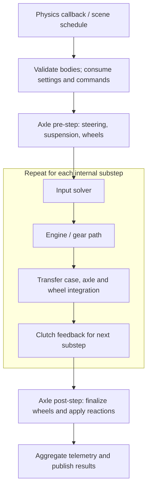

# Source Guide

This guide is for developers who want to understand or change the C++ implementation. You do not need to read every file: start with the diagram, then follow the path related to your task.

## The big picture

The component classes are the Unreal-facing API: they expose setup to the editor and Blueprints. Bridges move configuration, commands, and results between those components and the simulation state. Runtime classes coordinate each physics step; solver functions do the calculations.

| Path | High-level direction |
| --- | --- |
| Configuration and input | Components → Bridges → Runtime → Solvers |
| Published results | Runtime → Bridges → Components |
| Physics execution | Callback/schedule → Runtime ↔ Chaos bodies and contacts |

These paths are a conceptual map, not a promise that every class calls every adjacent layer directly. Physics callback admission and body/contact access are handled at explicit boundaries.

## Main layers

| Layer | Main files | What to look for |
| --- | --- | --- |
| Components | [VehicleDriveAssemblyComponent.h](../Source/KinetiForge/Public/VehicleDriveAssemblyComponent.h), [VehicleAxleAssemblyComponent.h](../Source/KinetiForge/Public/VehicleAxleAssemblyComponent.h), [VehicleWheelComponent.h](../Source/KinetiForge/Public/VehicleWheelComponent.h) | Reflected setup, component selection or creation, editor-facing configuration, input functions, and values exposed to users. |
| Bridges | [VehiclePowerUnitBridge.h](../Source/KinetiForge/Public/VehiclePowerUnitBridge.h), [VehicleAxleBridge.h](../Source/KinetiForge/Public/VehicleAxleBridge.h), [VehicleWheelBridge.h](../Source/KinetiForge/Public/VehicleWheelBridge.h) | How settings and commands reach simulation state, and how results are copied back for component-facing getters. |
| Runtime orchestration | [VehicleDriveRuntime.h](../Source/KinetiForge/Public/VehicleDriveRuntime.h), [VehiclePowerUnitRuntime.h](../Source/KinetiForge/Public/VehiclePowerUnitRuntime.h), [VehicleAxlePhysicsAssembly.h](../Source/KinetiForge/Public/VehicleAxlePhysicsAssembly.h), [VehicleWheelRuntime.h](../Source/KinetiForge/Public/VehicleWheelRuntime.h) | State held during simulation and the order in which vehicle, power-unit, axle, and wheel stages run. |
| Solvers | [VehicleInputSolver.h](../Source/KinetiForge/Public/VehicleInputSolver.h), [VehicleEngineSolver.h](../Source/KinetiForge/Public/VehicleEngineSolver.h), [VehicleDifferentialSolver.h](../Source/KinetiForge/Public/VehicleDifferentialSolver.h), [VehicleAxleSolver.h](../Source/KinetiForge/Public/VehicleAxleSolver.h), [VehicleSuspensionSolver.h](../Source/KinetiForge/Public/VehicleSuspensionSolver.h), [VehicleWheelSolver.h](../Source/KinetiForge/Public/VehicleWheelSolver.h) | The calculations for input processing, engine/drivetrain behavior, torque distribution, steering, suspension, and tire forces. |
| Physics and contact boundary | [VehiclePhysicsScene.h](../Source/KinetiForge/Public/VehiclePhysicsScene.h), [VehiclePhysicsSchedule.h](../Source/KinetiForge/Public/VehiclePhysicsSchedule.h), [VehicleSuspensionContactBridge.h](../Source/KinetiForge/Public/VehicleSuspensionContactBridge.h) | How work is admitted and scheduled, how physics bodies are resolved, and how collision queries and contact reactions are adapted. |

## What happens during a physics step

The normal Drive path enters `FVehicleDriveRuntime::Update` in [VehicleDriveRuntime.cpp](../Source/KinetiForge/Private/VehicleDriveRuntime.cpp) after physics callback scheduling:

At a high level, the runtime validates its body bindings before consuming commands, prepares the axles, then runs input processing, engine/gear output, torque distribution, wheel integration, and clutch feedback for each internal substep. It then finalizes the axles, aggregates vehicle telemetry, and publishes power-unit results. Suspension preparation and integration are distinct from tire/drivetrain integration. The diagram compresses the substep loop; see the implementation for exact ordering and exit conditions.

The main implementation handoffs are [VehicleDriveRuntime.cpp](../Source/KinetiForge/Private/VehicleDriveRuntime.cpp), [VehiclePowerUnitRuntime.cpp](../Source/KinetiForge/Private/VehiclePowerUnitRuntime.cpp), [VehicleAxlePhysicsAssembly.cpp](../Source/KinetiForge/Private/VehicleAxlePhysicsAssembly.cpp), and [VehicleWheelRuntime.cpp](../Source/KinetiForge/Private/VehicleWheelRuntime.cpp).

For torque distribution, follow `VehicleDriveRuntime.cpp` into `VehicleDifferentialSolver.h`: Drive uses it to calculate transfer-case output for each driven axle. For differential behavior within an axle, follow `VehicleAxlePhysicsAssembly.cpp` into `VehicleAxleSolver.h`.

## Suggested reading paths

### To understand how a vehicle is assembled

1. Read [VehicleDriveAssemblyComponent.h](../Source/KinetiForge/Public/VehicleDriveAssemblyComponent.h) for the reflected configuration and input surface.
2. Read [VehicleDriveAssemblyComponent.cpp](../Source/KinetiForge/Private/VehicleDriveAssemblyComponent.cpp) for component discovery, selection, generation, and runtime registration.
3. Follow the bridge/runtime types listed above to see how that setup reaches the simulation.

### To change simulation behavior

1. Start at [VehicleDriveRuntime.cpp](../Source/KinetiForge/Private/VehicleDriveRuntime.cpp) to understand where the stage runs.
2. Follow the relevant path through [VehiclePowerUnitRuntime.cpp](../Source/KinetiForge/Private/VehiclePowerUnitRuntime.cpp) or [VehicleAxlePhysicsAssembly.cpp](../Source/KinetiForge/Private/VehicleAxlePhysicsAssembly.cpp).
3. Read the relevant solver and, when available, its tests before changing behavior. Tests live under [Private/Tests](../Source/KinetiForge/Private/Tests); they can also serve as small examples of expected behavior.

For a conceptual explanation of the tire, suspension, and drivetrain calculations, see the [Physics Model Overview](PhysicsModels.md).

### To change callback, body, or contact behavior

Read [VehiclePhysicsScene.cpp](../Source/KinetiForge/Private/VehiclePhysicsScene.cpp), [VehiclePhysicsSchedule.cpp](../Source/KinetiForge/Private/VehiclePhysicsSchedule.cpp), [VehiclePhysicsStep.cpp](../Source/KinetiForge/Private/VehiclePhysicsStep.cpp), and [VehicleSuspensionContactBridge.cpp](../Source/KinetiForge/Private/VehicleSuspensionContactBridge.cpp). These files cover callback admission/scheduling, step execution, and the collision/contact adaptation boundary.

For thread ownership, registration, teardown, and manual-call requirements, see the [runtime maintenance guide](RuntimeMaintenance.md). It covers constraints that matter when changing lifecycle or callback code; it is not required for a first pass through the architecture.
